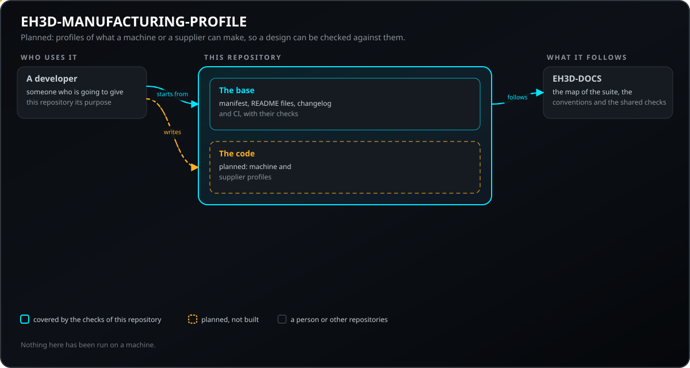
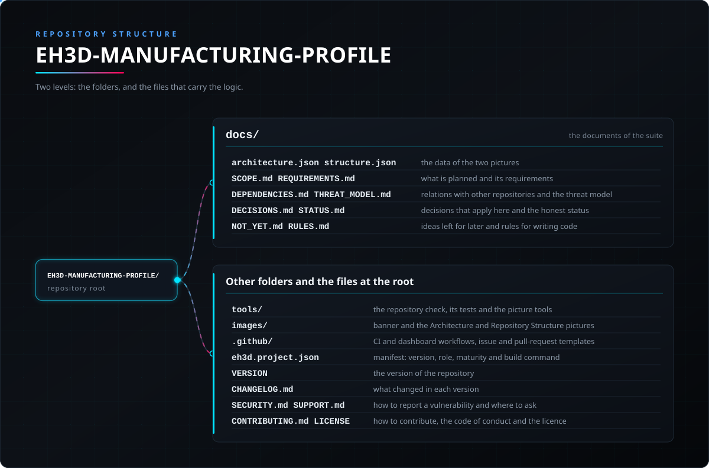

<p align="center">
  
</p>

#  EH3D-MANUFACTURING-PROFILE

<p align="center"><a href="README.md">🇺🇸 English</a> | <a href="README_spa.md">🇪🇸 Español</a> | <a href="README_fra.md">🇫🇷 Français</a> | <a href="README_ita.md">🇮🇹 Italiano</a> | 🇩🇪 <b>Deutsch</b> | <a href="README_zho.md">🇨🇳 中文</a> | <a href="README_jpn.md">🇯🇵 日本語</a> | <a href="README_por.md">🇵🇹 Português</a></p>

### EH3D-MANUFACTURING-PROFILE: Profile der Fähigkeiten von Werkstatt- und Fabrikmaschinen und der Einschränkungen von Lieferanten. Früher Code.

<p align="center">
  
  
  
  
  
  
</p>

---

**Ehrlichkeitscheck - was heute tatsächlich läuft:** eine Rust-Bibliothek und eine Befehlszeile, die ein JSON-Profil lesen, dessen Grenzen immer ihre Einheit tragen, und finden, was daran falsch ist (Zahlen ohne Einheit, fehlerhafte Grenzen, widersprüchliche Werkzeugdefinitionen, Einschränkungen ohne Quelle); sie zitieren es über den SHA-256 seines Inhalts und vergleichen die Messwerte eines Entwurfs mit den Grenzen, mit Nennung von Grenze, Quelle und Abhilfe. Alles lief nur mit Daten, die die eigenen Tests erzeugen. Es fehlen: das Lesen der Maschinendateien, die Server und Werkzeugverwaltung nutzen, und die Verbindung zum Prüfer.

---

> **Stand von Sicherheit und IT-Sicherheit:** dieses Repository steht am Anfang und ist kein Sicherheitssystem (Safety). Nichts hier Geschriebenes ersetzt die Grenzen, Verriegelungen und den Not-Aus der Maschine und ihrer Steuerung.

## 📋 Auf einen Blick

| | |
|---|---|
| Version | `0.0.2` |
| Reifegrad | Gerüst |
| Tests | 3 |
| Technologie-Stack | Markdown, Python 3.10+ |
| Auf echter Hardware | Noch nicht auf Hardware ausgeführt |

**Springe zu:** [Überblick](#-überblick) · [Architektur](#-architektur) · [Schnellstart](#-schnellstart) · [Tests](#-tests) · [Struktur des Repositorys](#-struktur-des-repositorys) · [Verwandte Projekte](#-verwandte-projekte)

## 🚦 Projektstatus

Jede Zeile ist ein Teil dieses Repositorys, und die Ampel sagt, wie weit er heute ist. Sie beruht auf dem, was das Repository zeigen kann (Tests, Builds, Läufe), nicht auf dem, was geplant ist.

🟢 Fertig und überprüft · 🟡 Funktioniert, mit bekannten Grenzen · 🟠 Teilweise fertig oder noch nicht überprüft · 🔴 Nicht gemacht oder funktioniert nicht

| Bereich | Stand | Was das hier bedeutet |
|---|---|---|
| Repository-Prüfungen | 🟡 | Die Repository-Prüfung, die Prüfung der Bilder und die 3 Tests der Basis laufen in der CI und bestehen. |
| Tests | 🟡 | Die 14 Tests des Rust-Codes und die 3 der Basis bestehen auf einem Rechner. Sie verwenden nur Daten, die die Tests selbst erzeugen. |
| Echte Hardware | 🟠 | Auf keiner Maschine und keiner Platine ausgeführt: nichts hier wurde auf Hardware ausprobiert. |
| Geplante Funktion | 🟠 | Geschrieben: das Profil mit Einheiten in jedem Namen, die Werkzeugtabelle, Lieferanten-Einschränkungen mit Quelle, der Hash, der ein Profil zitiert, und die Erklärung einer Verletzung. Nicht geschrieben: die Zuordnung der Maschinendateien von Server und Werkzeugverwaltung. |
| Anforderungen | 🟠 | 5 der 6 Anforderungen sind im Prototyp; die Zuordnung der Maschinendateien (MPRO-002) ist nur geplant. Keine ist validiert. |

## 🎯 Überblick

* **Was es gibt:** eine Bibliothek und eine Befehlszeile ohne Fenster, die ein JSON-Profil lesen, prüfen (`check`), seinen Hash ausgeben (`hash`) und die Messwerte eines Entwurfs damit vergleichen (`verify`). **Geplant:** das Lesen der Maschinendateien von Server und Werkzeugverwaltung, die Verbindung zum Prüfer und eine Art Serveraufgabe.

## 🧩 Rolle in EH3D

EH3D-MANUFACTURING-PROFILE gehört zur PHOENIX-Familie der EH3D Fabrication Suite. Was es tun wird, was es noch nicht tun wird, seine Anforderungen und seine Beziehungen zu anderen Repositories stehen im Ordner `docs/`.

## 🏛️ Architektur

<p align="center">
  
</p>

Wie die Teile dieses Repositorys zusammenpassen: wer es nutzt, was es enthält und wovon es abhängt. Das Bild wird aus `docs/architecture.json` gezeichnet und gegen den Code geprüft.

## 🚀 Schnellstart

Du brauchst Python 3.10 oder neuer; es gibt nichts zu installieren.

```bash
python -I tools/ci_validate.py
python -I tools/make_architecture.py --check
python -I tools/make_structure.py --check --readmes
python -I -m unittest discover -s tools -p "test_*.py"
```

## 🧪 Tests

Die Basis hat 3 Tests (`python -I -m unittest discover -s tools -p "test_*.py"`), und sie bestehen. Die CI führt die Repository-Prüfung, die Prüfung der Bilder und diese Tests aus.

## 🏗️ Build und Veröffentlichung

Die Version steht in der Datei `VERSION` und in `eh3d.project.json`, und jede Version hat ihren Eintrag in [CHANGELOG.md](CHANGELOG.md). Es gibt nichts zu bauen; Releases werden auf GitHub veröffentlicht.

## 📂 Struktur des Repositorys

<p align="center">
  
</p>

<details>
<summary>Textversion des Baums</summary>

```text
EH3D-MANUFACTURING-PROFILE/
├── docs/
│   ├── architecture.json structure.json         die Daten der beiden Bilder
│   ├── SCOPE.md REQUIREMENTS.md                 das Geplante und seine Anforderungen
│   ├── DEPENDENCIES.md THREAT_MODEL.md          Beziehungen zu anderen Repositories und Bedrohungsmodell
│   ├── DECISIONS.md STATUS.md                   hier geltende Entscheidungen und ehrlicher Status
│   ├── NOT_YET.md RULES.md                      Ideen für später und Regeln zum Schreiben von Code
│   └── adr/                                     die angenommenen Entscheidungsprotokolle
├── AGENTS.md                                    Regeln für alle, die das Repository ändern
├── src/                                         die Bibliothek und die Befehlszeile
├── Cargo.toml Cargo.lock deny.toml              Rust-Paket und Richtlinie der Abhängigkeiten
├── rust-toolchain.toml                          die festgelegte Rust-Toolchain
├── tools/                                       die Repository-Prüfung, ihre Tests und die Bild-Werkzeuge
├── images/                                      Banner und die Bilder von Architektur und Repository-Struktur
├── .github/                                     CI- und Dashboard-Workflows, Vorlagen für Issues und Pull Requests
├── eh3d.project.json                            Manifest: Version, Rolle, Reifegrad und Build-Befehl
├── VERSION                                      die Version des Repositorys
├── CHANGELOG.md                                 was sich in jeder Version geändert hat
├── SECURITY.md SUPPORT.md                       Schwachstellen melden und Fragen stellen
└── CONTRIBUTING.md CODE_OF_CONDUCT.md LICENSE   Mitwirken, Verhaltenskodex und Lizenz
```

</details>

## 🗺️ Roadmap und bekannte Grenzen

**Bekannte Grenzen heute**

* Früher Code: nur mit Daten der eigenen Tests ausgeführt; die Maschinendateien von Server und Werkzeugverwaltung werden noch nicht gelesen.

**Als Nächstes**

* Warten, bis die Verträge, von denen dieses Projekt abhängt, akzeptiert sind (siehe `docs/DEPENDENCIES.md`), dann die erste Version mit Tests schreiben und die Statuszeilen durch echte Ergebnisse ersetzen.

## 🌍 Sprachen

README und Texte gibt es auf Englisch, Spanisch, Französisch, Italienisch, Deutsch, Chinesisch, Japanisch und europäischem Portugiesisch.

## 🔗 Verwandte Projekte

* [EH3D-DOCS](https://github.com/JuanenRac/EH3D-DOCS): die Karte der Suite, ihre Architektur, die Konventionen und die gemeinsamen Prüfungen
* Geplante Beziehungen, noch nicht gebaut (EH3D-COMMON, EH3D-SERVER, EH3D-TOOL-MANAGER, EH3D-DESIGN-VERIFIER): siehe [docs/DEPENDENCIES.md](docs/DEPENDENCIES.md)

## 📚 Dokumentation

* [Die Konventionen der Suite](https://github.com/JuanenRac/EH3D-DOCS/blob/main/docs/CONVENTIONS.md)
* [Änderungsprotokoll](CHANGELOG.md)
* [Umfang, Anforderungen, Abhängigkeiten, Bedrohungsmodell und Entscheidungen](docs/SCOPE.md)

## 🤝 Mitwirken und Community

* Führe vor einem Pull Request `python -I tools/ci_validate.py` und die Tests der Basis aus: alles muss bestehen. Siehe [CONTRIBUTING.md](CONTRIBUTING.md) und den [Verhaltenskodex](CODE_OF_CONDUCT.md).
* Das README gibt es in acht Sprachen: Eine Textänderung wird in allen acht Dateien gemacht, und die beiden Bilder werden aus `docs/architecture.json` und `docs/structure.json` mit `tools/make_architecture.py` und `tools/make_structure.py` gezeichnet.
* Melde eine Schwachstelle privat: [SECURITY.md](SECURITY.md). Fragen, Ideen und Meldungen: electrohobby3d@gmail.com ([SUPPORT.md](SUPPORT.md)).

## 👤 AUTOR

**JuanenRac (Electro Hobby 3D)** · electrohobby3d@gmail.com

## 📜 LIZENZ

Software: GPL-3.0-or-later. Siehe [LICENSE](LICENSE). Die Hardware-Entwürfe der Suite verwenden die CERN OHL-S.
