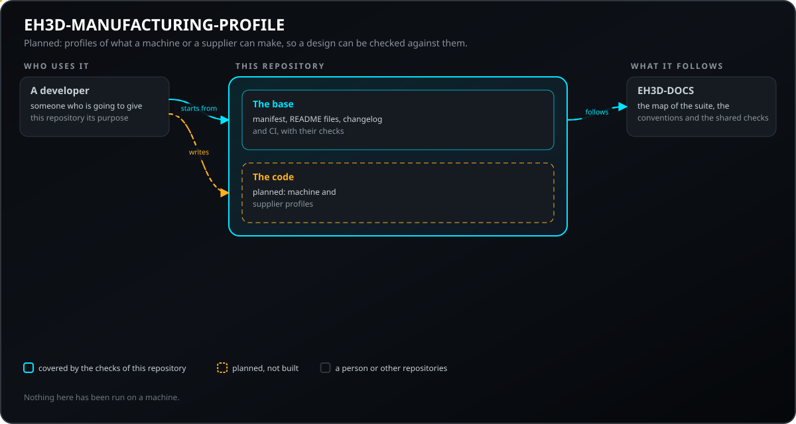
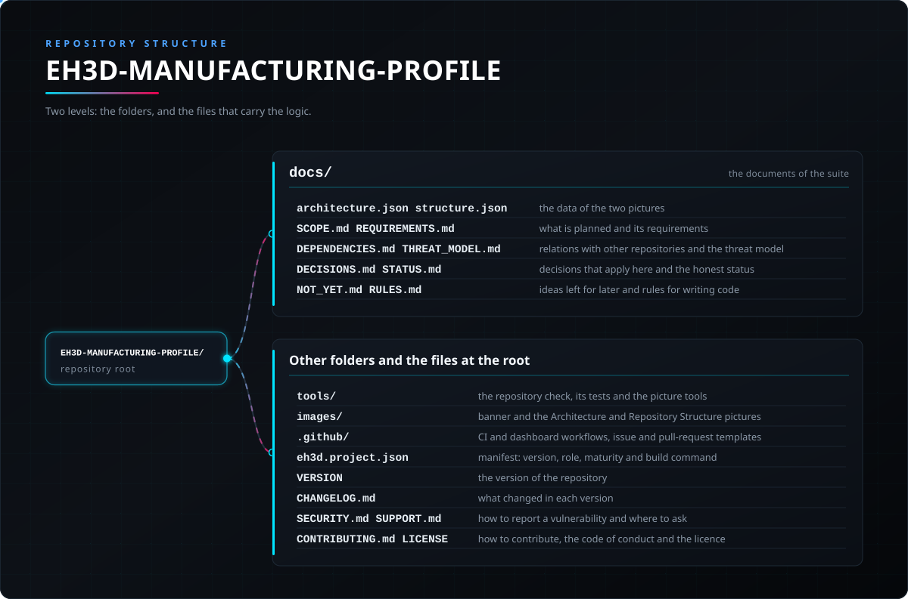

<p align="center">
  
</p>

# 🛠️ EH3D-MANUFACTURING-PROFILE

<p align="center"><a href="README.md">🇺🇸 English</a> | <a href="README_spa.md">🇪🇸 Español</a> | <a href="README_fra.md">🇫🇷 Français</a> | <a href="README_ita.md">🇮🇹 Italiano</a> | <a href="README_deu.md">🇩🇪 Deutsch</a> | <a href="README_zho.md">🇨🇳 中文</a> | 🇯🇵 <b>日本語</b> | <a href="README_por.md">🇵🇹 Português</a></p>

### EH3D-MANUFACTURING-PROFILE：工房や工場の機械の能力と、サプライヤーの制約のプロファイル。初期のコードがあります。

<p align="center">
  
  
  
  
  
  
</p>

---

**正直さの確認 - 今日実際に動くもの：** 制限値が常に単位を持つ JSON プロファイルを読み、問題を見つける Rust のライブラリとコマンドラインがあります。見つけるのは、単位のない数値、不正な制限、競合する工具定義、出典のない制約です。内容の SHA-256 でプロファイルを指し示し、設計の測定値を制限と比べて、制限・出典・対処を示します。すべて自身のテストが作ったデータでしか動かしていません。存在しないもの：サーバーと工具管理が使う機械ファイルの読み取り、検証ツールとの連携。

---

> **安全性とセキュリティの現状：** このリポジトリは最初の段階で、安全装置ではありません。ここに書かれたことが、機械とそのコントローラーの上限、インターロック、非常停止の代わりになることはありません。

## 📋 ひと目で

| | |
|---|---|
| バージョン | `0.0.1` |
| 成熟度 | 足場 |
| テスト | 3 |
| 技術スタック | Markdown, Python 3.10+ |
| 実機での動作 | まだハードウェアでは実行していません |

**移動先：** [概要](#-概要) · [アーキテクチャ](#-アーキテクチャ) · [クイックスタート](#-クイックスタート) · [テスト](#-テスト) · [リポジトリの構成](#-リポジトリの構成) · [関連プロジェクト](#-関連プロジェクト)

## 🚦 プロジェクトの状況

各行はこのリポジトリの一部分で、信号は今日どこまで進んでいるかを示します。計画ではなく、リポジトリが示せるもの（テスト、ビルド、実行）に基づいて書かれています。

🟢 完了・検証済み · 🟡 動作する（既知の制限あり） · 🟠 一部のみ、または未検証 · 🔴 未実装または動作しない

| 領域 | 状態 | ここでの意味 |
|---|---|---|
| リポジトリ チェック | 🟡 | リポジトリ チェック、画像のチェック、基盤の 3 件のテストは CI で実行され、通っています。 |
| テスト | 🟡 | Rust コードの 14 件と基盤の 3 件のテストがコンピューター上で成功します。使うのはテスト自身が作ったデータだけです。 |
| 実機 | 🟠 | どの機械やボードでも実行していません。ここにあるものは、ハードウェア上で試していません。 |
| 計画中の機能 | 🟠 | 作成済み：すべての名前に単位を持つプロファイル、工具表、出典付きのサプライヤー制約、プロファイルを指すハッシュ、違反の説明。未作成：サーバーと工具管理の機械ファイルとの対応付け。 |
| 要件 | 🟠 | 6 件のうち 5 件の要件はプロトタイプで、機械ファイルとの対応付け（MPRO-002）は計画のみです。検証済みのものはありません。 |

## 🎯 概要

* **あるもの：** ウィンドウのないライブラリとコマンドラインで、JSON プロファイルを読み、検査し（`check`）、ハッシュを表示し（`hash`）、設計の測定値と比べます（`verify`）。**計画中：** サーバーと工具管理の機械ファイルの読み取り、検証ツールとの連携、サーバーのタスクの一種。

## 🧩 EH3D での役割

EH3D-MANUFACTURING-PROFILE は EH3D Fabrication Suite の PHOENIX ファミリーの一部です。何をするか、まだ何をしないか、要件、他のリポジトリとの関係は `docs/` フォルダーに書かれています。

## 🏛️ アーキテクチャ

<p align="center">
  
</p>

このリポジトリの各部分の関係：誰が使い、何を持ち、何に依存するか。図は `docs/architecture.json` から描かれ、コードと照合されます。

## 🚀 クイックスタート

Python 3.10 以降が必要で、インストールするものはありません。

```bash
python -I tools/ci_validate.py
python -I tools/make_architecture.py --check
python -I tools/make_structure.py --check --readmes
python -I -m unittest discover -s tools -p "test_*.py"
```

## 🧪 テスト

基盤には 3 件のテストがあり（`python -I -m unittest discover -s tools -p "test_*.py"`）、通っています。CI はリポジトリ チェック、画像のチェック、これらのテストを実行します。

## 🏗️ ビルドとリリース

バージョンは `VERSION` ファイルと `eh3d.project.json` にあり、各バージョンには [CHANGELOG.md](CHANGELOG.md) の項目があります。ビルドするものはなく、リリースは GitHub で公開されます。

## 📂 リポジトリの構成

<p align="center">
  
</p>

<details>
<summary>ツリーのテキスト版</summary>

```text
EH3D-MANUFACTURING-PROFILE/
├── docs/
│   ├── architecture.json structure.json         2 つの図のデータ
│   ├── SCOPE.md REQUIREMENTS.md                 計画内容とその要件
│   ├── DEPENDENCIES.md THREAT_MODEL.md          他のリポジトリとの関係と脅威モデル
│   ├── DECISIONS.md STATUS.md                   適用される決定事項と正直な状況
│   ├── NOT_YET.md RULES.md                      後回しにしたアイデアとコードの記述規則
│   └── adr/                                     承認された決定の記録
├── AGENTS.md                                    リポジトリを変更する人のための規則
├── src/                                         ライブラリとコマンドライン
├── Cargo.toml  deny.toml                        Rust パッケージと依存関係の方針
├── tools/                                       リポジトリ チェック、そのテスト、画像のツール
├── images/                                      バナーとアーキテクチャ・リポジトリ構成の図
├── .github/                                     CI とダッシュボードのワークフロー、Issue と PR のテンプレート
├── eh3d.project.json                            マニフェスト：バージョン、役割、成熟度、ビルドコマンド
├── VERSION                                      リポジトリのバージョン
├── CHANGELOG.md                                 各バージョンの変更点
├── SECURITY.md SUPPORT.md                       脆弱性の報告方法と問い合わせ先
└── CONTRIBUTING.md CODE_OF_CONDUCT.md LICENSE   貢献方法、行動規範、ライセンス
```

</details>

## 🗺️ ロードマップと既知の制限

**現時点で分かっている制限**

* 初期のコード：自身のテストのデータでしか動かしていません。サーバーと工具管理の機械ファイルはまだ読みません。

**次のステップ**

* このプロジェクトが依存する契約が承認されるのを待ち（`docs/DEPENDENCIES.md` を参照）、その後テスト付きで最初のバージョンを書き、状態の行を実際の結果に置き換えます。

## 🌍 言語

README とテキストは、英語、スペイン語、フランス語、イタリア語、ドイツ語、中国語、日本語、ヨーロッパポルトガル語で提供されています。

## 🔗 関連プロジェクト

* [EH3D-DOCS](https://github.com/JuanenRac/EH3D-DOCS)：スイートの地図、アーキテクチャ、規約、共有チェック
* 計画中の関係（未構築）（EH3D-COMMON, EH3D-SERVER, EH3D-TOOL-MANAGER, EH3D-DESIGN-VERIFIER）：[docs/DEPENDENCIES.md](docs/DEPENDENCIES.md) を参照

## 📚 ドキュメント

* [スイートの規約](https://github.com/JuanenRac/EH3D-DOCS/blob/main/docs/CONVENTIONS.md)
* [変更履歴](CHANGELOG.md)
* [範囲、要件、依存関係、脅威モデル、決定事項](docs/SCOPE.md)

## 🤝 コントリビュートとコミュニティ

* プル リクエストの前に `python -I tools/ci_validate.py` と基盤のテストを実行してください。すべて通る必要があります。[CONTRIBUTING.md](CONTRIBUTING.md) と[行動規範](CODE_OF_CONDUCT.md)を参照してください。
* README は 8 言語あります。文章を変更するときは 8 つのファイルすべてを変更し、2 つの図は `docs/architecture.json` と `docs/structure.json` から `tools/make_architecture.py` と `tools/make_structure.py` で描画します。
* 脆弱性は非公開で報告してください：[SECURITY.md](SECURITY.md)。質問、アイデア、報告：electrohobby3d@gmail.com（[SUPPORT.md](SUPPORT.md)）。

## 👤 作者

**JuanenRac (Electro Hobby 3D)** · electrohobby3d@gmail.com

## 📜 ライセンス

ソフトウェア：GPL-3.0-or-later。[LICENSE](LICENSE) を参照。スイートのハードウェア設計には CERN OHL-S を使います。
